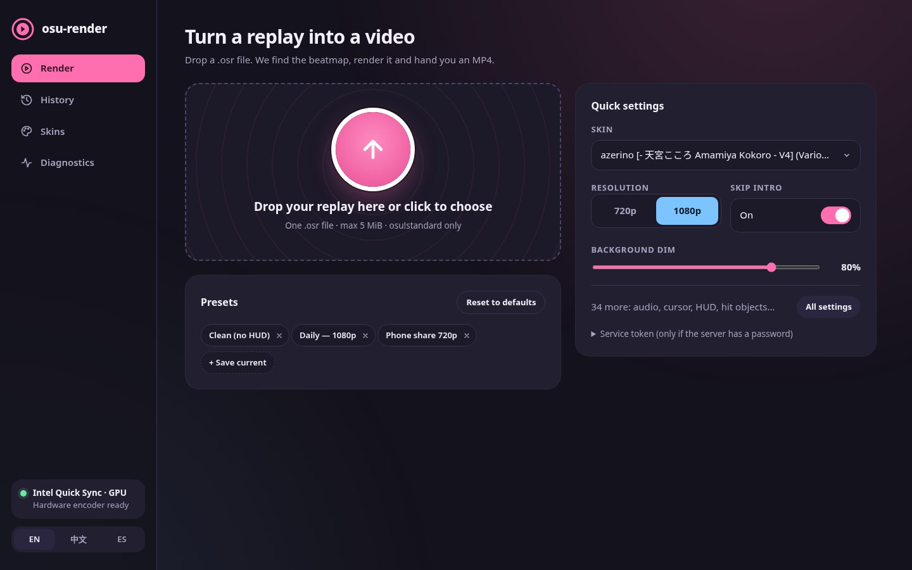
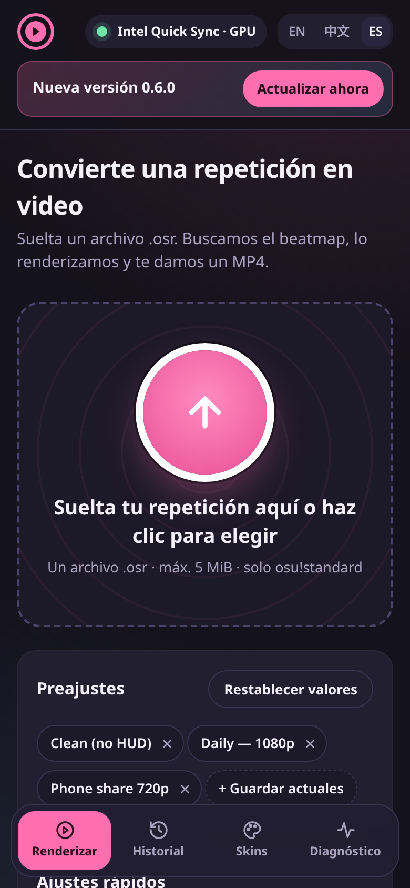

# osu-render

[English](README.md) · **繁體中文** · [Español](README.es.md)

自架的 osu! replay（`.osr`）轉 MP4 渲染服務，底層使用 [danser-go](https://github.com/Wieku/danser-go)。
把 replay 拖進網頁後，服務會透過 osu! API 找到對應圖譜、從 mirror 下載、交給 danser 渲染，最後產生
720p 或 1080p、60 FPS 的 MP4。影片編碼會盡量使用 GPU（NVIDIA NVENC、AMD AMF 或 Intel Quick Sync），
不能用時改用 CPU（x264）。

<p>
  
  
</p>

> **Windows 與 NVIDIA/AMD 支援是新功能，需要測試者。** 如果你有這類環境，最簡單的試用方式是
> [Windows 可攜版 zip](#windows-快速開始可攜版-zip推薦)，[傳回診斷報告](#回報測試結果給測試者)會很有幫助。

## 目錄

- [功能](#功能)
- [平台與 GPU 支援](#平台與-gpu-支援)
- [Windows 快速開始：可攜版 zip（推薦）](#windows-快速開始可攜版-zip推薦)
- [速度設定](#速度設定)
- [自訂皮膚](#自訂皮膚)
- [渲染歷史與保存期限](#渲染歷史與保存期限)
- [本機 osu! Songs 資料夾](#本機-osu-songs-資料夾)
- [更新](#更新)
- [回報測試結果（給測試者）](#回報測試結果給測試者)
- [常見問題](#常見問題)
- [從原始碼安裝](#從原始碼安裝)
  - [需求](#需求)
  - [osu! OAuth 應用程式](#osu-oauth-應用程式)
  - [Windows 從原始碼安裝](#windows-從原始碼安裝)
  - [Linux](#linux)
- [設定](#設定)
- [編碼器如何選擇](#編碼器如何選擇)
- [HTTP API](#http-api)
- [安全性說明](#安全性說明)
- [疑難排解](#疑難排解)
- [開發](#開發)
- [授權與致謝](#授權與致謝)

## 功能

- 拖放式網頁介面，支援 English、繁體中文、Español，分成「**渲染**」、「**歷史紀錄**」、「**Skin**」、「**診斷**」四個分頁，
  深色主題取材自 osu! 的元素：拖放區是一顆 hit circle，進度是 approach circle（手機上分頁變成浮在下方的分頁列）。
- 拖放區旁就是「**快速設定**」，其他選項都在可搜尋的「**所有設定**」面板；可以把設定存成具名的預設組合（存在瀏覽器裡），
  也能「**還原預設值**」。
- 逐步顯示任務進度（已上傳 → 尋找圖譜 → 下載 → 排隊 → 渲染 → 完成），以 approach circle 顯示百分比，並附渲染速度、剩餘時間與圖譜長度，完成後可直接在網頁上
  預覽影片。重新整理網頁後會接續顯示進行中的渲染。
- 只需上傳 replay。服務會用 checksum 透過 osu! API 找圖譜，從可設定的 mirror 下載（失敗會換下一個），
  渲染前再比對 replay 的 MD5。
- 720p 或 1080p、60 FPS，H.264 影像搭配 AAC 音訊。
- 速度設定（**速度**、**平衡**、**畫質**），在渲染時間與畫質之間取捨。
- 每個任務可單獨調整畫面：跳過前奏、音量、背景暗度／模糊／視差、Bloom、遊戲區縮放、游標大小／軌跡／特效、
  Skin 或圖譜配色、HUD 元件與 hit object 細節。
- 自訂皮膚：在「**Skin**」分頁上傳 `.osk`（或直接放進 `data/skins`），每次渲染都能選擇。
- 自動偵測 GPU 編碼器，並實際編碼一個 frame 做自我測試；失敗時改用 x264。
- SQLite 持久化 FIFO 佇列，一次只渲染一個任務，當機或重啟後可自動恢復。
- 磁碟保護：剩餘空間不足時拒絕新任務；影片與 replay 24 小時後過期（`VIDEO_RETENTION_HOURS`），快取圖譜依最久未使用（LRU）清除。
- 每個用戶端都有渲染歷史紀錄，可預覽、下載或刪除檔案。
- 下載前先用本機 osu!stable `Songs` 資料夾裡的圖譜，未上架的圖譜也能渲染。
- 精簡的 HTTP API，影片下載支援 Range，可選用 bearer token。
- 內建診斷報告（`doctor.bat`、`npm run doctor` 或網頁介面），方便回報問題。
- Windows 可攜版 zip：內含 Node.js 與 danser-go，什麼都不用安裝。

## 平台與 GPU 支援

| 平台 | 編碼器 | 狀態 |
| --- | --- | --- |
| Linux | Intel Quick Sync（`h264_qsv`） | 已驗證 |
| Linux | NVIDIA NVENC（`h264_nvenc`） | 已實作，需要測試者 |
| Linux | AMD AMF（`h264_amf`） | 實驗性：需要 AMD 專有的 AMF runtime，多數環境會退回 x264 |
| Windows 10 / 11 | NVIDIA NVENC（`h264_nvenc`） | 已實作，需要測試者 |
| Windows 10 / 11 | AMD AMF（`h264_amf`） | 已實作，需要測試者 |
| Windows 10 / 11 | Intel Quick Sync（`h264_qsv`） | 已實作，需要測試者 |
| 全部 | CPU x264（`libx264`） | 備援，一定可用（較慢） |
| macOS | — | 不支援 |

HEVC 版本（`hevc_nvenc`、`hevc_amf`、`hevc_qsv`）可用 `RENDER_ENCODER` 強制指定。

## Windows 快速開始：可攜版 zip（推薦）

可攜版 zip 什麼都有：程式本體、Node.js runtime，以及附帶 FFmpeg 的 danser-go。不需要安裝 Node.js、Git 或
danser。適用 Windows 10 / 11 64 位元。

1. **下載**：到[最新版 Release](https://github.com/956zs/osu-render/releases/latest) 下載
   `osu-render-<版本>-win-x64.zip`。
2. **解壓縮到任何你有寫入權限的地方**，例如 `C:\osu-render` 或「文件」裡的資料夾。不要放在 `C:\Program Files`
   裡（服務會把資料寫在自己旁邊），也不要放在雲端同步資料夾裡。
   選用：解壓縮前在 zip 上按右鍵 → **內容** → 勾選**解除封鎖**，之後 Windows 的警告會少一些。
3. **建立 osu! OAuth 應用程式**（只需一次，大約一分鐘）：
   1. 開啟 <https://osu.ppy.sh/home/account/edit>，捲到 **OAuth**，按 **New OAuth Application**。
   2. 名稱隨意。**Application Callback URL** 填 `http://127.0.0.1:3030/`（服務不會用到它，留白也可以）。
   3. 頁面先別關：等一下需要 **Client ID**（一串數字）與 **Client Secret**。
4. **雙擊 `start.bat`。** 第一次執行時會詢問 client ID 與 client secret（輸入 secret 時畫面不會顯示，貼上後按 Enter 即可），
   並存到同一個資料夾的 `.env`。
   secret 只留在你的電腦上，不要分享給別人。
5. **服務準備好後，瀏覽器會自動開啟 <http://127.0.0.1:3030/>**，把 `.osr` replay 拖進頁面即可。
   右上角的標籤會顯示目前使用的編碼器（例如 *GPU · NVIDIA NVENC*）。

**請保持主控台視窗開著。** 那個視窗就是服務本身：關掉它會停止服務以及正在進行的渲染。下次再執行 `start.bat`
即可啟動（設定問題只會問一次）。

> [!IMPORTANT]
> danser 需要 GPU 驅動提供的 OpenGL 3.3，這只存在於**你已登入的桌面工作階段**。請在桌面上以一般使用者身分執行
> `start.bat`。它無法以 Windows 服務、設為「不論使用者登入與否均執行」的排程工作，或透過 SSH／遠端 shell 執行。

**SmartScreen 與 Defender。** 批次檔與 danser 的執行檔都沒有程式碼簽章。如果 SmartScreen 顯示「Windows 已保護您的
電腦」，請按 **其他資訊 → 仍要執行**。Defender 第一次可能會掃描 `danser-cli.exe` 與 FFmpeg，讓第一次啟動或渲染
變慢；如果它隔離了檔案，請還原並把 `danser` 資料夾加入排除項目。zip 請只從本專案的
[Releases](https://github.com/956zs/osu-render/releases) 頁面下載。

**修改設定。** 用記事本編輯解壓縮資料夾裡的 `.env`（見[設定](#設定)），然後關掉主控台視窗、重新執行 `start.bat`。
想重新回答第一次的設定問題，刪掉 `.env` 即可。

**更新到新版本。** 從 0.4.0 起，按頁面最上方橫幅裡的 **立即更新** 即可，見[更新](#更新)。

**zip 裡有什麼**（最上層資料夾 `osu-render\`）：

| 路徑 | 內容 |
| --- | --- |
| `start.bat` | 啟動服務（第一次會詢問 osu! 憑證）並開啟瀏覽器。 |
| `set-webhook.bat` | 在 `.env` 設定回報給開發者用的 webhook，見[回報測試結果](#回報測試結果給測試者)。 |
| `doctor.bat` | 執行診斷檢查，並開啟報告所在的資料夾，見[回報測試結果](#回報測試結果給測試者)。 |
| `runtime\node.exe` | Node.js 24 LTS（官方 Windows x64 版本，打包時驗證過 checksum）。 |
| `danser\` | Windows 版 danser-go 0.12.1，未經修改，含它附帶的 FFmpeg。 |
| `dist\`、`public\`、`config\`、`node_modules\`、`package.json` | 程式本體（已編譯，只含正式環境相依套件）。 |
| `scripts\windows\setup.ps1` | `start.bat` 使用的首次設定程式。 |
| `scripts\windows\apply-update.ps1` | `start.bat` 重新啟動服務時安裝已下載的更新，見[更新](#更新)。 |
| `VERSION.json` | 這個 zip 內 osu-render、Node.js 與 danser 的版本（更新程式會讀取）。 |
| `.env.example` | `.env` 的範本，每個設定都有說明。 |
| `README*.md`、`LICENSE`、`THIRD_PARTY_NOTICES.txt` | 說明文件、本專案授權，以及隨附軟體的授權。 |

`data\`（資料庫、replay、影片、圖譜快取、日誌與報告）與 `.env` 會在第一次執行時建立在這些檔案旁邊。

隨附的第三方軟體各自保有原授權：Node.js（MIT 等）、danser-go（GPL-3.0）與 danser 內附的 FFmpeg，以及
`node_modules` 裡的 npm 套件。完整清單見 zip 內的 `THIRD_PARTY_NOTICES.txt`。

## 速度設定

「**快速設定**」裡有「**速度設定**」切換，會依這次渲染使用的編碼器設定 preset 與品質數值，預設為「**平衡**」。

| 設定 | NVIDIA NVENC | AMD AMF | Intel Quick Sync | x264（CPU） |
| --- | --- | --- | --- | --- |
| **速度** | `p1`、CQ 24 | `speed`、QP 22 | `veryfast`、ICQ 23 | `veryfast`、CRF 20 |
| **平衡** | `p4`、CQ 22 | `balanced`、QP 20 | `faster`、ICQ 20 | `faster`、CRF 18 |
| **畫質** | `p7`、CQ 20 | `quality`、QP 18 | `slow`、ICQ 15 | `medium`、CRF 16 |

HEVC 編碼器使用相同的 preset，品質數值加 2。數值越低畫面越清晰、檔案越大。「**速度**」還會關閉這次渲染的
**Bloom**，不管「**全部設定**」裡的 **Bloom** 開關怎麼設（選「**速度**」時該開關會變灰）。

在 Intel Iris Xe 筆電（Quick Sync）以 1080p 渲染一張 3:20 的圖譜實測：「**速度**」50 秒（實際時間的 4.2 倍速、296 MB）、
「**平衡**」61 秒（3.4 倍、391 MB）、「**畫質**」73 秒（2.9 倍、711 MB）。

這些表格放在 `config/defaults.json` 的 `speedProfiles`（各編碼器家族每個設定的 preset 與品質、HEVC 加值、會關閉
Bloom 的設定），可以在 `config/local.json` 覆寫。渲染選項名稱是 `speedProfile`（`fast`、`balanced` 或 `quality`），
其他值會以 `INVALID_OPTIONS` 拒絕。

## 自訂皮膚

打開「**Skin**」分頁，把 `.osk` 檔拖進去（或點擊選擇檔案）。皮膚會安裝到伺服器上，並用於下一次渲染；之後也會留在清單中。
按「**用於下一次渲染**」可以選用已安裝的皮膚，「**渲染**」分頁「**快速設定**」裡的 **皮膚** 清單也一樣。在「**所有設定**」
開啟 **使用皮膚的游標** 會改用皮膚自己的游標，而不是 danser 的。上傳同名皮膚會
取代舊的。

也可以手動加入皮膚：把皮膚資料夾（含有 `skin.ini` 的那一層）或 `.osk` 檔複製到皮膚資料夾，可攜版是
`data\skins`，其他安裝方式是 `data/skins`（可用 `DANSER_SKINS_DIR` 更改）。放進去的 `.osk` 會在網頁下次載入
皮膚清單時自動解壓。`default` 是 danser 內建的皮膚。上限（每個 `.osk` 200 MiB、解壓後大小、檔案數）設定在
`config/defaults.json` 的 `skins` 區段。

## 渲染歷史與保存期限

「**歷史紀錄**」分頁會列出你最近在這台伺服器上的渲染（最新的在前，最多 20 筆）：圖譜、玩家、mod、解析度、編碼器、
渲染花了多久，以及檔案什麼時候會被刪除。完成的影片有「**預覽**」（直接在網頁上播放）與「**下載**」按鈕。**刪除檔案** 會立刻刪除影片、replay 與日誌，
紀錄本身會留在清單上並標示為已刪除。清單只會顯示從你自己的位址上傳的渲染（可攜版就是你這台電腦），有渲染進行時會
自動重新整理。

完成、失敗與取消的渲染，其影片、replay 與日誌會保留 `VIDEO_RETENTION_HOURS` 小時（預設 24，可設 1 到 720），之後
自動刪除。在 `.env` 設定後重新啟動即可。

## 本機 osu! Songs 資料夾

如果同一台電腦有安裝 osu!stable，你已經有的圖譜會直接從它的 `Songs` 資料夾複製，不再查詢與下載。這樣未上架或只有
本機才有的圖譜也能渲染，而且不用下載任何東西。

- Windows：會自動找到 `%LOCALAPPDATA%\osu!\Songs`。要關閉，在 `config/local.json` 寫
  `"localSongs": { "autoDetect": false }`。
- 其他資料夾：在 `.env` 設定 `OSU_SONGS_DIRS`，多個資料夾在 Windows 用 `;`、在 Linux 用 `:` 分隔。
- 啟動時會在背景建立索引（之後只重新讀取新增或修改過的 `.osu`），所以 Songs 很大時，安裝後第一次啟動可能要一分鐘
  左右。這段期間照樣可以渲染，還沒索引到的圖譜會改用 API 與 mirror。進度寫在日誌裡，索引狀態會出現在診斷報告中。
- 圖譜會複製到 `data/songs`，不會修改你的 osu! 資料夾。連結（symlink／junction）資料夾會被略過。
- 本機複製因任何原因失敗時，會改回用 osu! API 與 mirror。
- 不支援 osu!lazer（它用雜湊值存放檔案，沒有 Songs 資料夾）。

## 更新

**可攜版 zip（0.4.0 起）：在網頁上直接更新。** osu-render 啟動時，以及你開啟網頁時（之後每 10 分鐘，網頁開著時也會定期確認），會向 GitHub
查詢最新版本。有新版時，頁面最上方會出現「osu-render X 已推出」的橫幅。按 **立即更新** 並確認：

1. 服務會從本 repo 的 [Releases](https://github.com/956zs/osu-render/releases) 下載新的 zip、檢查 SHA-256
   checksum，並解壓縮到 `data\update\staging\`。其中任何一步失敗都不會改動任何檔案，頁面也會顯示失敗。
2. osu-render 停止，`start.bat` 在同一個視窗裡安裝新檔案並重新啟動。頁面會自動重新整理，並顯示「已更新到 osu-render X」。

會保留不動的：`.env`、`data` 資料夾（影片、上傳的皮膚、圖譜快取、日誌）、`config\local.json`，以及 danser 的
`settings` 資料夾、`danser.db` 與 `skins` 資料夾。只有新版附帶不同版本的 danser 時才會替換 danser 本身。舊的程式檔案會移到
`data\update\backup-<舊版本>`（只保留最新一份備份）。安裝失敗時會自動放回舊檔案並重新啟動舊版本，詳細資訊在
`data\update\apply-update.log`。

有影片在排隊或算圖時會拒絕更新，請等它完成。只有用 `start.bat` 啟動服務時才能更新。要關閉更新檢查，建立
`config\local.json`，內容為 `{ "update": { "enabled": false } }`。

**可攜版 zip，手動更新**（0.4.0 以前的版本沒有更新按鈕，需要手動更新一次）：

1. 關掉主控台視窗。
2. 把新版本解壓縮到一個**新的**資料夾。
3. 從舊資料夾把 `.env` 與整個 `data` 資料夾複製到新資料夾。如果你建立或修改過 `danser\settings\default.json`，
   也一起複製。
4. 從新資料夾執行 `start.bat`。確認一切正常後再刪除舊資料夾。

**從原始碼安裝**（`git clone`）：橫幅只會顯示提示，因為服務無法替換自己的 git 工作目錄。請這樣更新：

```sh
git pull
npm ci
npm run build
```

然後重新啟動服務（使用 systemd unit 時執行 `sudo systemctl restart osu-render`，否則停止後重新執行 `npm start`）。

## 回報測試結果（給測試者）

不論成功或失敗，一份報告就能告訴我們你的 GPU、驅動、編碼器，以及每個編碼器自我測試的結果。

### 最簡單：自動把報告傳給開發者

如果維護者私下（例如私訊）給了你一個**回報用 webhook 網址**：

1. 如果還沒執行過，先執行一次 `start.bat`（第一次執行會建立 `.env`，也會詢問這個網址；在那裡貼上就可以跳過下一步）。
2. 在 osu-render 資料夾中雙擊 **`set-webhook.bat`**，貼上網址後按 Enter。輸入內容不會顯示；網址無效時會拒絕並要求重新輸入。
   `.env` 裡的其他設定都會保留。
3. 關掉 `start.bat` 的視窗，再重新執行 `start.bat`。如果 `.env` 裡的網址無效，黑色視窗會顯示警告。

備用方式（手動）：對 `.env` 按右鍵 →「**開啟方式**」→「**記事本**」，找到靠近最後的 `REPORT_WEBHOOK_URL=` 這一行，把網址貼在
`=` 後面，不要加引號或空格（舊版建立的 `.env` 沒有這一行，請自己加在最後）。存檔後重新啟動。Windows 預設會隱藏副檔名，
請確認檔名真的是 `.env` 而不是 `.env.txt`：記事本存檔時有時會加上 `.txt`，而 osu-render 不會讀取 `.env.txt`（`start.bat`
發現這種檔案時會警告）。在檔案總管選「**檢視 → 顯示 → 副檔名**」即可看到真正的檔名。

之後每次渲染結束（成功、失敗或逾時；取消的不算）都會把一份遮蔽過個人資訊的報告送到維護者的 Discord 頻道，「**診斷**」
分頁也會多出「**傳送給開發者**」按鈕，可以手動傳送（例如啟動時就出問題）。自動報告會沿用啟動時的編碼器自我測試結果，
不會重新測試，所以不會干擾渲染。訊息會寫出這次渲染的編碼器、解析度、耗時與平均速度（例如 `41.0 s, 1.82x avg`）；
因非預期內部錯誤而失敗的渲染，還會多一行 `Detail:` 寫出簡短的錯誤訊息。網址錯誤時，服務會在啟動時顯示警告（並記錄 `report_webhook_invalid`），並在不回報的狀態下繼續執行；網址有效時會記錄 `report_webhook_enabled`。

請不要把網址給別人：任何拿到網址的人都能在那個頻道發訊息。

### 其他回報方式

以下方式產生的是同一份報告：

- **Windows zip：** 雙擊 **`doctor.bat`**。它會印出摘要、儲存 `data\diagnostics\doctor-<timestamp>.json`，並在
  檔案總管開啟該資料夾。服務執行中或已停止時都可以執行。
- **網頁介面：** 「**診斷**」分頁有「**下載報告**」（JSON 檔）、「**複製摘要**」（適合貼到聊天的短文字）與
  「**開啟 GitHub issue**」（在新分頁開啟預先填好的 issue 表單）。因為要測試每個編碼器，產生報告可能需要幾秒。
  同一個分頁也會顯示渲染器狀態（編碼器、顯示環境、可用磁碟空間），產生報告後還會列出每個編碼器的自我測試結果。
- **從原始碼執行：** `npm run doctor`（摘要）或 `npm run doctor -- --json`（印出 JSON）。兩者都會把檔案寫到
  `data/diagnostics/`。`GET /api/diagnostics` 也會回傳這份 JSON。

doctor 會對**所有**支援的編碼器做自我測試，而不只是第一個成功的，所以一份報告就能看到 NVENC / AMF / QSV / x264
的完整狀況。接著可以用 [GPU / platform report](https://github.com/956zs/osu-render/issues/new?template=gpu-report.yml)
範本開 issue（附上或貼上 JSON），或直接把檔案傳給維護者。如果有渲染失敗，請順便說明大約的時間與頁面上顯示的訊息。

### 隱私

- **包含：** 作業系統名稱／版本／架構、CPU 型號、核心數、記憶體大小、GPU 名稱、廠商與驅動版本、danser 與 FFmpeg
  版本及 FFmpeg 編碼器清單、編碼器自我測試結果（含 FFmpeg 錯誤輸出的結尾）、啟動檢查結果、設定摘要（host、port、
  編碼器設定、mirror 主機名稱，以及 OAuth 憑證、`AUTH_TOKEN` 與 `REPORT_WEBHOOK_URL` *是否*有設定）、剩餘磁碟空間、最近 20 個任務的
  中繼資料（狀態、編碼器、解析度、耗時、平均渲染速度、錯誤代碼、發生非預期內部錯誤時一段已移除資料夾路徑的簡短
  錯誤訊息，以及一小段 danser 日誌結尾，其中可能出現圖譜名稱），以及 danser
  `danser.log` 的摘要（版本、OpenGL 使用的 GPU）。
- **不包含：** OAuth client ID 與 secret、`AUTH_TOKEN`、webhook 網址、IP 位址、玩家名稱、replay 與圖譜檔案。
  家目錄會被替換成 `~`，使用者名稱替換成 `<user>`。
- **沒有設定 `REPORT_WEBHOOK_URL` 時，不會自動傳送任何東西。** 此時服務不會上傳資料，要不要分享由你決定。設定之後，
  上述報告（加上一段簡短摘要訊息）會在每次渲染結束時，以及你按下「**傳送給開發者**」時，送到該網址所屬的 Discord
  頻道。webhook 網址本身不會被寫進日誌或報告。「**開啟 GitHub issue**」按鈕只是在瀏覽器開啟
  預先填好的頁面（內容會放在網址中送到 github.com），在你按下 **Submit** 之前不會發佈。GitHub issue 是公開的，
  貼出前請先看過報告內容。

## 常見問題

**它會上傳任何東西嗎？**
沒有任何遙測。服務只會連到 osu! API（取得 token、用 checksum 查圖譜），以及 `BEATMAP_MIRRORS` 裡的圖譜 mirror
（下載 `.osz`）。replay 與影片都留在你的電腦上，24 小時後刪除（`VIDEO_RETENTION_HOURS`）。診斷報告只有在你自己分享，或設定了 `REPORT_WEBHOOK_URL`（每次渲染後會把遮蔽過的報告送到該 Discord webhook）時
才會離開電腦，見[隱私](#隱私)。

**可以把它設成 Windows 服務嗎？**
不行。danser 需要已登入桌面工作階段裡的 OpenGL 驅動；Windows 服務跑在 session 0，那裡只有基本的 OpenGL 1.1，
每次渲染都會失敗。想自動啟動的話，請用工作排程器建立**登入時執行、只在使用者登入時執行**的工作，見
[Windows 從原始碼安裝](#windows-從原始碼安裝)（可攜版請讓工作執行 `start.bat`）。

**會用哪張 GPU？**
影片編碼使用第一個通過啟動自我測試的編碼器，Windows 上的順序是 NVIDIA → AMD → Intel（Linux 是 NVIDIA → Intel →
AMD），都不行就用 CPU。頁面右上角的標籤會顯示結果，也可以用 `RENDER_ENCODER` 強制指定，見
[編碼器如何選擇](#編碼器如何選擇)。danser 的 OpenGL 繪圖由 Windows／驅動決定，在筆電上可能是另一張 GPU，見
[疑難排解](#疑難排解)（雙顯示卡筆電與 `danser.log`）。

**區網裡的朋友可以用嗎？**
可以。在 `.env` 設定 `HOST=0.0.0.0` 與一組夠長的隨機 `AUTH_TOKEN`，然後重新啟動。Windows 防火牆詢問時，允許
Node.js 在**私人**網路通訊（或新增 TCP 3030 連接埠的輸入規則）。朋友開啟 `http://<你電腦的區網 IP>:3030/`，
展開「**快速設定**」底部的「**服務 Token**」輸入 token（伺服器要求 token 時會自動展開）。渲染一次只跑一個，每個用戶端最多 3 個未完成的任務。沒有 HTTPS 的話不要
直接開放到網際網路，見[安全性說明](#安全性說明)。

## 從原始碼安裝

適用於 Linux，或是想在 Windows 上用 Git checkout 而不是 zip 執行的情況。

### 需求

- **Node.js 22.12 以上**（建議使用目前的 LTS）。Windows 請用 64 位元版本。
- **danser-go 0.11 以上，建議 0.12.1。** 從 [danser-go releases](https://github.com/Wieku/danser-go/releases)
  下載對應作業系統的 zip。裡面已附 danser 使用的 FFmpeg，不需要另外安裝 FFmpeg。
- **osu! OAuth 應用程式**（client ID 與 secret），見[下方](#osu-oauth-應用程式)。
- **GPU 驅動程式**（想用硬體編碼時）：
  - NVIDIA：較新的 GeForce/Studio 驅動。太舊的驅動在 NVENC 自我測試會出現
    `Driver does not support the required nvenc API version`。
  - AMD：Windows 上安裝 Adrenalin 驅動（內含 AMF runtime）。Linux 上 AMF 需要 AMD 專有 runtime，
    多數發行版沒有提供。
  - Intel：Intel 顯示驅動，而且內顯必須啟用。有獨立顯卡的桌機常在 BIOS/UEFI 把內顯關掉
    （找「iGPU Multi-Monitor」之類的選項）。Linux 上 Quick Sync 另外需要 `intel-media-driver` 與 oneVPL GPU
    runtime（`vpl-gpu-rt`，部分發行版叫 `libmfx-gen1` / `onevpl-intel-gpu`）。
- **磁碟空間：** 建議保留至少 15 GiB。低於 8 GiB 時會拒絕新任務。

### osu! OAuth 應用程式

服務使用 osu! API v2 的 **client credentials** 授權：只讀取公開的圖譜資料，不做任何使用者登入。

1. 開啟 <https://osu.ppy.sh/home/account/edit>，捲到 **OAuth**，按 **New OAuth Application**。
2. 名稱隨意。**Application Callback URL** 可以留白；如果表單強制要求，填 `http://127.0.0.1:3030/`
   （服務不會用到它）。
3. 把 **Client ID** 與 **Client Secret** 填進 `.env` 的 `OSU_CLIENT_ID` 與 `OSU_CLIENT_SECRET`
   （可攜版的 `start.bat` 會幫你做）。secret 只留在伺服器端，不會送到瀏覽器。不要分享給別人。

### Windows 從原始碼安裝

> [!IMPORTANT]
> 服務必須在**你已登入的 Windows 桌面工作階段**中執行（一般的終端機視窗，或「只在使用者登入時執行」的工作排程器
> 工作）。它**無法**以 Windows 服務、「不論使用者登入與否均執行」或透過 SSH 執行：這些情況跑在 session 0 或
> 非互動式工作階段，只有 GDI Generic OpenGL 1.1，而 danser 需要 GPU 驅動提供的 OpenGL 3.3。

1. 安裝 [Node.js LTS](https://nodejs.org/) 與 [Git](https://git-scm.com/)（也可以在 GitHub 用
   **Code → Download ZIP** 代替 `git clone`）。在 PowerShell：

   ```powershell
   winget install OpenJS.NodeJS.LTS
   winget install Git.Git
   ```

   裝完後開一個新的 PowerShell 視窗，讓 `node` 與 `npm` 出現在 `PATH`。

2. 從 [danser-go releases](https://github.com/Wieku/danser-go/releases) 下載 `danser-0.12.1-win.zip`，
   解壓縮到例如 `C:\danser`（確認 `C:\danser\danser-cli.exe` 存在）。
   SmartScreen 或 Defender 可能會對未簽章的 exe 發出警告，見[疑難排解](#疑難排解)。

3. 取得程式碼並建立設定檔：

   ```powershell
   git clone https://github.com/956zs/osu-render.git
   cd osu-render
   Copy-Item .env.example .env
   notepad .env
   ```

   至少設定：

   ```ini
   DANSER_DIR=C:/danser
   OSU_CLIENT_ID=12345
   OSU_CLIENT_SECRET=your-secret
   ```

   正斜線（`C:/danser`）或一般反斜線（`C:\danser`）都可以，不要加引號。

4. 安裝、建置、檢查、啟動：

   ```powershell
   npm ci
   npm run build
   npm run doctor
   npm start
   ```

   `npm run doctor` 會列出找到的東西（danser、FFmpeg、GPU、哪些編碼器通過自我測試）並儲存報告，
   見[回報測試結果](#回報測試結果給測試者)。

5. 開啟 <http://127.0.0.1:3030/>，拖入 replay。服務執行期間請保持終端機開著。

**選用：登入時自動啟動。** 可以用工作排程器在登入時執行 `npm start`。在專案資料夾的 PowerShell 中：

```powershell
$action   = New-ScheduledTaskAction -Execute "cmd.exe" -Argument "/c npm start" -WorkingDirectory (Get-Location).Path
$trigger  = New-ScheduledTaskTrigger -AtLogOn -User $env:USERNAME
$settings = New-ScheduledTaskSettingsSet -ExecutionTimeLimit ([TimeSpan]::Zero) -AllowStartIfOnBatteries -DontStopIfGoingOnBatteries
Register-ScheduledTask -TaskName "osu-render" -Action $action -Trigger $trigger -Settings $settings
```

這會建立一個只在你登入時執行的工作，正是 danser 需要的。不要改成「不論使用者登入與否均執行」。
要移除時執行 `Unregister-ScheduledTask -TaskName osu-render`。
可攜版的話，在解壓縮後的資料夾執行同樣的指令，並改用 `-Argument "/c start.bat"`（請在第一次執行之後，`.env` 已經存在時）。

### Linux

```sh
# 1. danser（zip 內沒有執行權限，要自己加）
mkdir -p ~/danser
unzip danser-0.12.1-linux.zip -d ~/danser
chmod +x ~/danser/danser ~/danser/danser-cli ~/danser/ffmpeg/bin/ffmpeg ~/danser/ffmpeg/bin/ffprobe
# danser 0.11 是扁平結構：chmod +x ~/danser/danser-cli ~/danser/ffmpeg/ffmpeg ~/danser/ffmpeg/ffprobe

# 2. 服務本體
git clone https://github.com/956zs/osu-render.git ~/osu-render
cd ~/osu-render
cp .env.example .env
$EDITOR .env        # DANSER_DIR=<echo ~/danser 的輸出>、OSU_CLIENT_ID、OSU_CLIENT_SECRET
npm ci
npm run build
npm run doctor
npm start           # 然後開啟 http://127.0.0.1:3030/
```

服務會自己找到 danser 附帶的 FFmpeg 函式庫（0.12 在 `ffmpeg/lib`，0.11 在 `ffmpeg/`），不需要設定
`LD_LIBRARY_PATH`。

**顯示：** danser 0.12 以上在 Linux 會離屏渲染，不需要顯示器，headless 主機也能用。danser 0.11 會開一個隱藏
視窗，需要執行中圖形工作階段的 `DISPLAY` 或 `WAYLAND_DISPLAY`。

**systemd --user：** [`systemd/osu-render.service`](systemd/osu-render.service) 是範例 unit，預設專案在
`~/osu-render`、danser 在 `~/danser`。先修改路徑（以及 `node` 的路徑），然後：

```sh
mkdir -p ~/.config/systemd/user
cp systemd/osu-render.service ~/.config/systemd/user/
systemctl --user daemon-reload
systemctl --user enable --now osu-render.service
journalctl --user -u osu-render.service -f
```

想在登出後繼續執行，請啟用 lingering：`loginctl enable-linger "$USER"`（danser 0.12 以上沒問題；danser 0.11
本來就需要桌面工作階段）。

## 設定

設定從服務資料夾中的 `.env` 讀取（原始碼的專案根目錄，或可攜版解壓縮後的資料夾）。實際環境變數中已經有的值優先於
`.env`。路徑可以是絕對路徑，或相對於該資料夾的路徑。空值視同未設定。修改後請重新啟動服務。

| 變數 | 預設值 | 說明 |
| --- | --- | --- |
| `HOST` | `127.0.0.1` | 監聽位址。修改前請先看[安全性說明](#安全性說明)。 |
| `PORT` | `3030` | HTTP 連接埠。 |
| `DATA_DIR` | `./data` | 資料庫、replay、影片、圖譜、日誌與診斷報告。 |
| `DANSER_DIR` | `./danser` | danser 解壓縮的資料夾。 |
| `DANSER_BIN` | `<DANSER_DIR>/danser-cli`（Windows 為 `.exe`） | danser CLI 執行檔，放在別處時才需要設定。 |
| `DANSER_BASE_SETTINGS` | `<DANSER_DIR>/settings/default.json` | 渲染時作為基礎的 danser 設定（見下方）。 |
| `DANSER_SKINS_DIR` | `<DATA_DIR>/skins` | 傳給 danser 的 Skin 資料夾。 |
| `OSU_SONGS_DIRS` | Windows：`%LOCALAPPDATA%\osu!\Songs`（存在時） | 下載前先使用的 osu!stable `Songs` 資料夾，以 `;`（Windows）或 `:`（Linux）分隔。見[本機 osu! Songs 資料夾](#本機-osu-songs-資料夾)。 |
| `VIDEO_RETENTION_HOURS` | `24` | 完成渲染的影片、replay 與日誌保留幾小時，1 到 720。 |
| `DANSER_SETTINGS_NAME` | `service` | 服務寫出的設定檔名稱：`<DANSER_DIR>/settings/<name>.json`。只能用英數字、`-` 與 `_`。 |
| `RENDER_ENCODER` | `auto` | `auto`、`h264_nvenc`、`hevc_nvenc`、`h264_amf`、`hevc_amf`、`h264_qsv`、`hevc_qsv` 或 `libx264`。其他值會讓啟動失敗並顯示錯誤。 |
| `OSU_CLIENT_ID` | 空 | osu! OAuth client ID。必填。 |
| `OSU_CLIENT_SECRET` | 空 | osu! OAuth client secret。必填。 |
| `BEATMAP_MIRRORS` | `https://mirror.hinamizawa.ai/api/v1/hinai/d/{id}` | 以逗號分隔的 `.osz` 下載網址，依序嘗試。`{id}` 是 beatmapset ID。 |
| `AUTH_TOKEN` | 空 | 有設定時，每個 `/api/*` 請求都需要 `Authorization: Bearer <token>`。 |
| `MAX_QUEUE` | `20` | 未完成任務的上限。 |
| `REPORT_WEBHOOK_URL` | 空 | Discord webhook（`https://discord.com/api/webhooks/<id>/<token>`，也接受 `discordapp.com`、`ptb.` 與 `canary.`），每次渲染結束與按下「**傳送給開發者**」時會收到遮蔽過的診斷報告。其他網址會在啟動時警告並停用。屬於機密：不會寫進日誌或報告。見[回報測試結果](#回報測試結果給測試者)。 |

**danser 基礎設定。** 服務會複製 `DANSER_BASE_SETTINGS`，覆寫必要的項目（資料夾、60 FPS、編碼器、輸出），再寫到
`<DANSER_DIR>/settings/<DANSER_SETTINGS_NAME>.json`。基礎檔不存在時使用 danser 內建預設值。想要一份可以調整
（Skin、游標等）的基礎檔，請在 danser 資料夾執行一次 `danser-cli -noupdatecheck`：它會建立 `settings/default.json`、
印出 `No beatmap specified, closing...` 後結束。

不屬於機密的可調參數放在 [`config/defaults.json`](config/defaults.json)：各平台的編碼器自動順序、自我測試的尺寸與
逾時、診斷報告大小、issue 連結，回報 webhook 的逾時、429 重試上限、訊息間隔與日誌結尾大小（`reportWebhook`），以及更新檢查（`update`：開關、GitHub repo、檢查間隔、下載大小上限與允許的下載主機），影片預覽簽章連結的有效時間（`preview.ttlSeconds`，預設 3600 秒）、[速度設定](#速度設定)（`speedProfiles`），以及卡住偵測（`render.stallTimeoutMs`，預設 120000：danser 這麼久完全沒有輸出時，渲染會以 `RENDER_STALLED` 中止）。要修改時，建立只含要覆寫鍵值的 `config/local.json`；它會合併到預設值之上，且被 git
忽略。範例：

```json
{ "encoders": { "autoOrder": { "win32": ["h264_qsv", "libx264"] } } }
```

## 編碼器如何選擇

danser 只檢查編碼器名稱是否存在於 FFmpeg；如果 GPU 或驅動其實無法使用，渲染會在中途失敗。所以服務啟動時會用 danser
的 FFmpeg 對每個候選**編碼一個 240×144 的黑色 frame**，採用第一個成功的：

| `RENDER_ENCODER` | 候選順序 |
| --- | --- |
| Windows 上的 `auto` | `h264_nvenc` → `h264_amf` → `h264_qsv` → `libx264` |
| Linux 上的 `auto` | `h264_nvenc` → `h264_qsv` → `h264_amf` → `libx264` |
| 指定某個編碼器 | 該編碼器 → `libx264` |

最後落到 `libx264` 時仍可渲染，但 `/health` 會回報 `"status": "degraded"`，`reason` 為
`"hardware_encoder_unavailable"`（auto 模式）或 `"encoder_unavailable"`（你強制指定的編碼器失敗）。degraded 期間會不時
重新檢查（在 `/health` 請求與新任務時），之後 GPU 變得可用時不需重啟就會切換過去。

## HTTP API

有設定 `AUTH_TOKEN` 時，每個 `/api/*` 呼叫都要加上 `-H "Authorization: Bearer $AUTH_TOKEN"`。

| 方法與路徑 | 說明 |
| --- | --- |
| `POST /api/renders` | multipart 上傳：`replay`（`.osr`，最大 5 MiB）與選用的 `options`（JSON 字串）。回傳 `{ "id", "status" }`。 |
| `GET /api/renders/:id` | 任務狀態、進度、佇列位置、圖譜（`id`、`beatmapsetId`、`checksum`、`title`、`artist`、`version`）、輸出格式、`startedAt`、`renderMs` 與錯誤。渲染中另有 `speed`（數字，例如 `1.42`）與 `eta`（danser 印出的文字）；完成後有 `avgSpeed`（平均渲染速度，例如 `1.82`）與 `previewUrl`（簽章過的影片連結，見下一列）。 |
| `GET /api/renders/:id/video` | 完成的 MP4，檔名為 `Artist - Title [Version].mp4`，支援 HTTP `Range`。也接受簽章過的 `previewUrl`（`?exp=<unix 秒數>&sig=<hex>`）取代 Bearer header，讓 `<video>` 元素可以播放。簽章連結在 `preview.ttlSeconds`（預設 1 小時）後失效，服務重新啟動後也會失效（金鑰每次啟動隨機產生）；無效或過期的連結回傳 `UNAUTHORIZED`（403）。 |
| `DELETE /api/renders/:id` | 取消任務。 |
| `GET /api/renders?limit=N` | 你最近的渲染（只限同一個用戶端位址，預設 20、最多 100）：`{ "renders": [{ "id", "status", "createdAt", "completedAt", "expiresAt", "beatmap": { "id", "beatmapsetId", "title", "artist", "version" }, "player", "mods", "resolution", "encoder", "renderMs", "avgSpeed", "videoAvailable", "filesDeleted", "error", "previewUrl" }] }`。 |
| `DELETE /api/renders/:id/files` | 立刻刪除你自己已結束渲染的影片、replay 與日誌，歷史紀錄會保留。還在執行時回傳錯誤 `RENDER_ACTIVE`（409）。已刪除的影片回傳 `RENDER_EXPIRED`（410）。 |
| `GET /api/skins` | 已安裝的皮膚：`{ "skins": [{ "name" }] }`，內建的 `default` 排第一。 |
| `POST /api/skins` | multipart 上傳：`skin`（`.osk` 檔）。安裝後回傳 `{ "name" }`，或錯誤 `SKIN_INVALID`（422）／`SKIN_TOO_LARGE`（413）。 |
| `GET /api/diagnostics` | 診斷報告（與 `npm run doctor` 相同的 JSON）。 |
| `GET /api/update` | 更新狀態：`{ "current", "latest", "available", "portable", "enabled", "notesUrl", "checkedAt" }`，上次查詢 GitHub 失敗時另有 `error`。最多每 `update.checkIntervalMs` 查詢 GitHub 一次。 |
| `POST /api/update/apply` | 僅限用 `start.bat` 啟動的可攜版 zip：下載、驗證並準備最新版本，回傳 `{ "applying": true, "version" }`，然後透過 `start.bat` 重新啟動來安裝。錯誤：`UPDATE_NOT_PORTABLE`（409）、`UPDATE_BUSY`（409，有未完成的算圖或正在更新）、`UPDATE_FAILED`（502，沒有改動任何檔案）。 |
| `POST /api/diagnostics/send` | 把診斷報告送到 `REPORT_WEBHOOK_URL`。回傳 `{ "sent": true }`，或錯誤 `REPORT_WEBHOOK_DISABLED`（409，未設定）／`REPORT_SEND_FAILED`（502）。 |
| `GET /health` | 服務健康狀態（不需驗證）：`status`、`renderer`、`display`、`encoder`、`encoderKind`、`platform`、`queue`、`freeDiskBytes`、`reason`、`reportWebhook`、`bloomOffProfiles`（會關閉 Bloom 的速度設定）。 |

```sh
curl -F replay=@my-play.osr -F 'options={"resolution":"720p","skipIntro":true}' http://127.0.0.1:3030/api/renders
curl http://127.0.0.1:3030/api/renders/<id>
curl -o my-play.mp4 http://127.0.0.1:3030/api/renders/<id>/video
```

任務狀態：`uploaded` → `resolving` → `downloading` → `queued` → `rendering` → `finalizing` → `completed`，或
`failed` / `cancelled`。限制：只支援 osu!standard replay、圖譜最長 15 分鐘、每次渲染最多 30 分鐘、每分鐘最多上傳
5 次、每個用戶端最多 3 個未完成任務。

## 安全性說明

- 服務預設只監聽 `127.0.0.1`，只有你自己的電腦連得到。
- **對外開放前請先設定 `AUTH_TOKEN`**（`HOST=0.0.0.0`、port forwarding 或反向代理）。token 保護 `/api/*`；網頁上
  有欄位可以輸入。token 要經過不信任的網路時，請用 HTTPS（反向代理）。短時效、簽章過的 `previewUrl` 影片連結是
  唯一不需要 token 就能存取的 `/api` 路徑。
- 網頁帶有嚴格的 Content-Security-Policy：腳本、樣式與請求都只限同源，不允許行內腳本或樣式，也不能被嵌入其他網頁
  （`frame-ancestors 'none'`）。
- 瀏覽器無法傳入任意的 danser 或 FFmpeg 參數或檔案路徑。渲染選項會經過白名單檢查，轉換成固定的 danser 參數與設定修改。
- 下載的 `.osz` 會以防禦性方式解壓縮：限制項目數與總大小，不允許絕對路徑、`..`、符號連結或其他特殊檔案、Windows
  保留名稱（`CON`、`NUL`、`COM1`…）或只差大小寫的重複名稱，而且 `.osu` 檔必須符合 replay 的圖譜 MD5。
- OAuth secret、`AUTH_TOKEN` 與 `REPORT_WEBHOOK_URL` 留在 `.env`（git 會忽略），不會送到瀏覽器，也不會出現在診斷報告
  或日誌中。只有設定 `REPORT_WEBHOOK_URL` 時報告才會送到 Discord，而且只會送到 `discord.com`／`discordapp.com`。

## 疑難排解

**`/health` 顯示 degraded。** 看 `reason` 欄位（頁面上的狀態標籤也會顯示）：

| reason | 意義／處理方式 |
| --- | --- |
| `renderer_unavailable` | 找不到 danser-cli。檢查 `DANSER_DIR` / `DANSER_BIN`；Linux 上執行 `chmod +x`。可攜版請確認 `danser\danser-cli.exe` 存在（可能被 Defender 隔離）。 |
| `display_unavailable` | Linux 使用 danser 0.11 且沒有 `DISPLAY` / `WAYLAND_DISPLAY`。從桌面工作階段啟動，或改用 danser 0.12 以上。 |
| `hardware_encoder_unavailable` | 沒有 GPU 編碼器通過自我測試，改用 CPU 渲染（較慢）。見下方。 |
| `encoder_unavailable` | `RENDER_ENCODER` 指定的編碼器失敗（可用時改用 x264），或完全沒有可用的編碼器。 |
| `storage_low` | `DATA_DIR` 剩餘空間低於 8 GiB。 |

**GPU 編碼器自我測試失敗。** 執行 `doctor.bat` / `npm run doctor`，查看報告中的 `encoderProbes[].error`：

- NVIDIA：`Driver does not support the required nvenc API version` 或 `No capable devices found` 表示驅動太舊，
  或 NVIDIA GPU 沒有啟用（筆電：接上電源並確認獨顯沒有被停用）。請更新驅動。
- AMD：`amfrt64.dll` 或 AMF 相關錯誤表示沒有安裝 Adrenalin 驅動或版本太舊。
- Intel：QSV / MFX session 錯誤通常是內顯在 BIOS/UEFI 被關閉或驅動太舊。Linux 上請安裝 `intel-media-driver`
  與 `vpl-gpu-rt`。

**雙顯示卡筆電（NVIDIA Optimus／AMD 切換式顯示卡）。** danser 的 OpenGL 可能跑在內顯上。開啟 Windows
**設定 → 系統 → 顯示器 → 圖形**，新增 `danser-cli.exe`（可攜版在 `danser` 資料夾中），在 **選項** 選擇
**高效能** 並儲存。也可以在 NVIDIA 控制面板的個別程式設定中指定。

**查看 danser 實際用了什麼。** danser 每次執行都會在自己的資料夾寫入 `danser.log`，內容包括 `danser-go version`、
實際使用的 OpenGL vendor／renderer／version（可看出是哪張 GPU 在繪圖），以及 FFmpeg 的路徑與參數。每個任務的日誌
保存在 `data/logs/`。

**`RENDER_TIMEOUT`。** 渲染超過 30 分鐘而被中止。多半發生在較慢的機器使用 CPU 備援時；可改用 720p、修好 GPU
編碼器，或查看 `data/logs/` 中的渲染日誌。

**`RENDER_STALLED`。** danser 有 2 分鐘完全沒有輸出（沒有進度也沒有其他訊息），所以渲染被中止。錯誤的編碼器選項
可能讓 danser 這樣卡住。請查看 `data/logs/` 中的渲染日誌、換一個速度設定試試，並送出報告。如果只是超大的圖譜或
storyboard 需要更久才能載入，可以在 `config/local.json` 調高 `render.stallTimeoutMs`。

**`start.bat` 或 `doctor.bat` 顯示「osu-render files are missing」。** zip 是直接在檔案總管的 zip 檢視中開啟，或沒有
完整解壓縮。在 zip 上按右鍵 → **全部解壓縮**，再從解壓縮後的資料夾執行 `.bat`。

**`start.bat` 顯示連接埠已被使用。** osu-render 多半已經在另一個視窗執行，所以它會直接開啟網頁後結束。如果開出來的
不是 osu-render，請在 `.env` 改用其他 `PORT`。

**`start.bat` 顯示「osu-render stopped with an error」。** 看那一行上方的訊息，然後執行 `doctor.bat` 並把報告傳回來。
不要解壓縮到 `C:\Program Files`（資料夾必須可以寫入）。

**Windows SmartScreen / Defender 擋住 danser。** danser 的執行檔沒有簽章。只從 danser 的
[GitHub releases](https://github.com/Wieku/danser-go/releases) 下載（或使用本專案 Release 的 zip）。解壓縮前可以在
zip 上按右鍵 → **內容** → 勾選**解除封鎖**。如果仍出現 SmartScreen，選 **其他資訊 → 仍要執行**。若 Defender 隔離了
檔案，請還原並把 danser 資料夾加入排除項目。

**PowerShell 對 `npm` 顯示「因為這個系統上已停用指令碼執行」。** 改用 `npm.cmd`，或允許本機指令碼：
`Set-ExecutionPolicy -Scope CurrentUser RemoteSigned`。

**`npm ci` 試圖編譯 `better-sqlite3`。** 請用 64 位元的 Node.js 22 或 24（有預先編譯好的版本）；其他版本需要
Visual Studio Build Tools。

**連接埠已被占用（`EADDRINUSE`）。** 有其他程式（或另一份服務）在用 3030。在 `.env` 改 `PORT`，或找出該程式：
`Get-NetTCPConnection -LocalPort 3030`（Windows）/ `ss -ltnp 'sport = :3030'`（Linux）。

**Windows 上只有在背景啟動時渲染失敗。** 服務必須在你的桌面工作階段中執行，見[常見問題](#常見問題)中的
「可以把它設成 Windows 服務嗎？」。

## 開發

```sh
npm ci
npm run dev     # 用 tsx 直接執行 TypeScript
npm test        # 建置後執行 node:test 測試
```

CI（[`.github/workflows/ci.yml`](.github/workflows/ci.yml)）會在 Ubuntu 與 Windows 上跑測試（Node 24，Ubuntu 另跑
Node 22），並有一個 smoke job 在兩個平台下載 danser 0.12.1，檢查 `npm run doctor` 能找到 danser 與 FFmpeg，且 x264
自我測試通過。CI runner 沒有 GPU，硬體編碼器只能靠大家在實機執行 doctor 來測試。

發佈是自動的：**在 `package.json` 調高版本號，push 到 main，release 就會自動發佈。**（`npm version 0.5.0 --no-git-tag-version`
會同時更新 `package.json` 與 `package-lock.json`。）每次 push 到 main，`.github/workflows/release.yml` 會檢查 tag
`v<版本>` 是否存在。不存在時，它會在 Windows runner 上依 `packaging/` 中的檔案組裝可攜版 zip，對解壓縮後的副本做
smoke test（包含程式內更新：保留與替換 danser 兩種情況、失敗回復，以及 `start.bat` 在 exit code 75 時重新啟動），
然後建立 tag 與 GitHub Release，附上 zip 與它的 SHA-256 checksum。沒有改版本號的 push 不會發佈任何東西。手動 push
`v*` tag 也仍然可以，release 只會建立一次。

## 授權與致謝

[MIT](LICENSE) © 2026 956zs。

- 渲染使用 Wieku 的 [danser-go](https://github.com/Wieku/danser-go)（GPL-3.0）。它不在本儲存庫中；Windows 可攜版
  zip 附帶一份未經修改的副本。
- 可攜版 zip 也附帶 [Node.js](https://nodejs.org/)。詳見 zip 內的 `THIRD_PARTY_NOTICES.txt`。
- osu! 是 ppy Pty Ltd 的商標。本專案與 ppy 無關，也未獲其背書。
